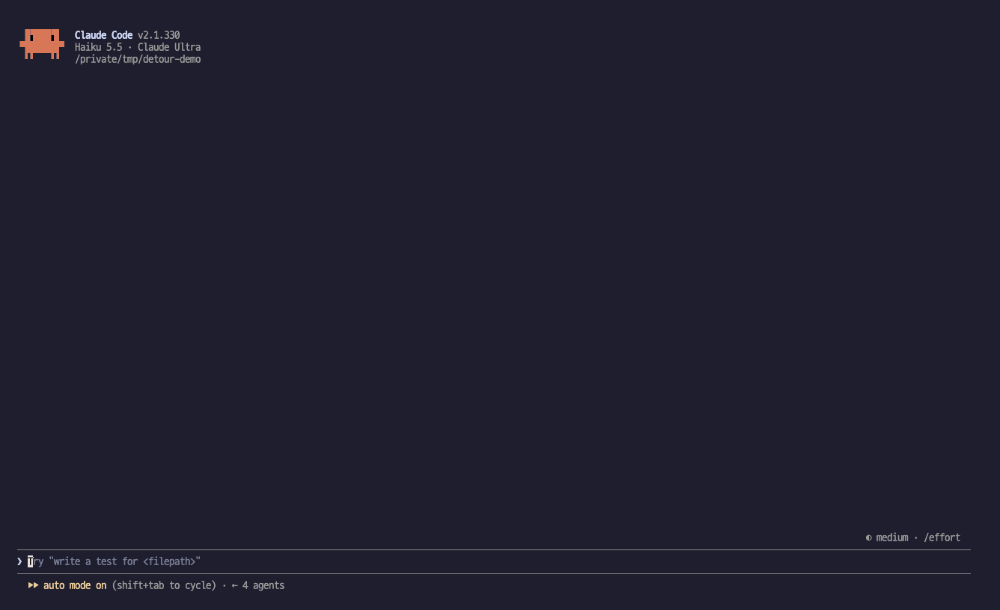
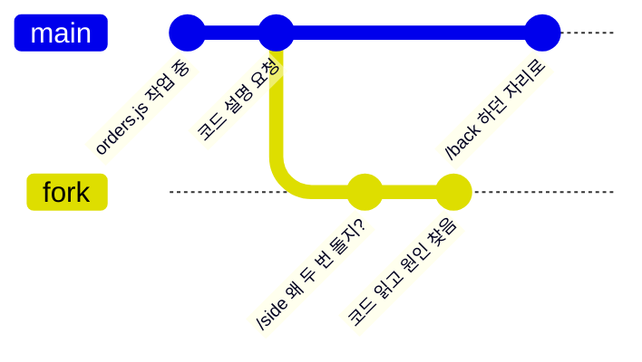

<h1 align="center">detour</h1>

<p align="center">
  <b>Claude Code 대화를 잠깐 fork해서 딴 질문을 하고,<br>아무 일 없었던 것처럼 원래 자리로 돌아옵니다.</b>
</p>

<p align="center">
  
  
  <a href="README.md"></a>
</p>

<p align="center">
  
</p>

<p align="center"><sub><code>/back</code>으로 돌아온 main은 fork하기 전에 나눈 대화만 기억합니다.</sub></p>

## 만든 이유

기능을 만들다가 궁금한 게 생기면 보통 그 대화에서 바로 물어봅니다. 몇 번 주고받다 보면 하던 작업은 저 위로 밀려나고 컨텍스트도 지저분해집니다. `/branch`로 따로 떼면 되지만 돌아가려면 `/resume` 목록을 뒤져야 합니다. `/btw`는 빠르지만 파일 하나 열어 보지 못합니다.

detour는 나가고 돌아오는 걸 명령어 하나씩으로 끝냅니다.



## 설치

Claude Code 입력창에서:

```
/plugin install detour --marketplace pjw81226/detour
```

마켓플레이스를 추가할지 물으면 `y`를 누르고 설치 범위를 고르면 됩니다. 셸에서는 `claude plugin install detour --marketplace pjw81226/detour`입니다.

## 사용법

| 명령 | 하는 일 |
|---|---|
| `/side <질문>` | 지금 시점에서 대화를 fork하고, fork한 세션에서 질문을 보냅니다. Claude가 작업 중이면 끝난 뒤에 fork합니다. |
| `/back` | fork하기 전 세션의 그 시점으로 돌아갑니다. fork에서 나눈 대화는 가져오지 않습니다. |
| `/tree` | 이 세션의 fork 목록을 오른쪽 패널에 띄웁니다. 클릭하면 그 세션으로 옮기고, `rename`으로 이름을 바꿀 수 있습니다. |

fork 안에 있는 동안은 입력창 위에 `fork: <제목> | /back to return`이 보입니다.

## 참고

- 대화만 fork합니다. fork에서 수정한 파일은 그대로 남고, `/back` 할 때 어떤 파일인지 알려 줍니다.
- `/side`가 대기 중일 때 Esc를 누르면 Claude Code가 다음 입력 전까지 플러그인 입력을 막습니다. 입력창에 `/side <질문>`이 다시 들어가 있으니 Enter만 누르면 됩니다.
- 기본 `/branch`로 직접 만든 세션에서도 `/back`이 됩니다.
- Claude Code 2.1.330에서 확인했습니다.

## 개발

```bash
claude --plugin-dir plugins/claude-code      # 받은 폴더에서 바로 실행
claude plugin test plugins/claude-code       # 단위 시험
claude plugin validate plugins/claude-code   # 구조와 API 사용 검사
python3 -I scripts/e2e.py                    # 별도 Claude Code로 실제 왕복 확인(모델 호출 몇 번)
vhs scripts/demo/demo.tape                   # docs/demo.gif(영어) 다시 녹화
vhs scripts/demo/demo.ko.tape                # docs/demo.ko.gif(한국어) 다시 녹화
```

`scripts/e2e.py`는 중간에 끊겨도 시험 폴더, 시험 세션, 플러그인 기록을 지웁니다. `~/.claude.json`의 시험 폴더 항목과 `~/.claude/history.jsonl`의 시험 줄은 남습니다. 떠 있는 Claude Code가 같이 쓰는 파일이라 건드리지 않습니다.

## 라이선스

MIT
