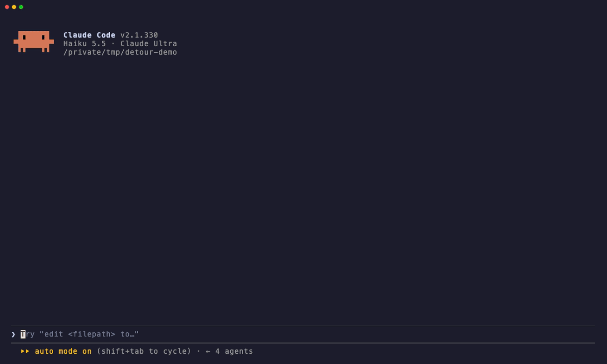
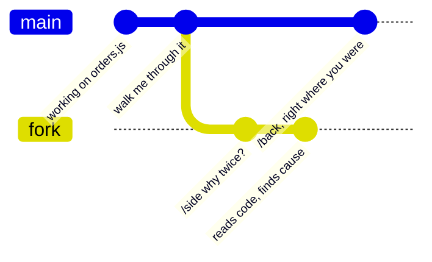

<h1 align="center">detour</h1>

<p align="center">
  <b>Fork your Claude Code conversation for a side question.<br>Come back like it never happened.</b>
</p>

<p align="center">
  
  
  <a href="README.ko.md"></a>
</p>

<p align="center">
  
</p>

<p align="center"><sub>Fork as often as you like, click any fork in the tree to jump to it. Back in main, Claude only knows what you asked before the fork.</sub></p>

## Why

You are halfway through a feature and a question pops up. Ask it in the same chat and your work gets buried under the detour. `/branch` keeps it apart, but getting back means digging through `/resume`. `/btw` is quick, but it can't open a single file.

detour makes the round trip one command each way.



## Install

At the prompt of a Claude Code session:

```
/plugin install detour --marketplace pjw81226/detour
```

Answer `y` to add the marketplace, then pick a scope. From a shell: `claude plugin install detour --marketplace pjw81226/detour`.

## Usage

| Command | What it does |
|---|---|
| `/side <question>` | Forks the conversation here and asks the question in the fork. If Claude is busy, it forks when the turn ends. |
| `/back` | Goes back to the session you forked from, right where you left it. Nothing from the fork comes along. |
| `/tree` | Opens a pane with the forks of this session. Click one to switch, or `rename` it. |

While you are in a fork, the line above the prompt reads `fork: <title> | /back to return`.

## Good to know

- Only the conversation forks. Files you edit in a fork stay edited, and `/back` tells you which ones.
- Press Esc while `/side` is waiting and Claude Code pauses plugin input until you type again. detour puts `/side <question>` back in the prompt box, so just hit Enter.
- `/back` also works in a session you split with the built-in `/branch`.
- Tested on Claude Code 2.1.330.

## Development

```bash
claude --plugin-dir plugins/claude-code      # run from a checkout
claude plugin test plugins/claude-code       # unit tests
claude plugin validate plugins/claude-code   # structure and API use
python3 -I scripts/e2e.py                    # real round trip in a separate Claude Code (a few model calls)
node scripts/demo/record.mjs en              # re-record docs/demo.gif (needs ttyd, ffmpeg, Chrome)
node scripts/demo/record.mjs ko              # re-record docs/demo.ko.gif
```

`scripts/e2e.py` removes its test folder, test sessions and plugin records, even when interrupted. It leaves the test folder's entry in `~/.claude.json` and its lines in `~/.claude/history.jsonl`, because a running Claude Code shares those files.

## License

MIT
